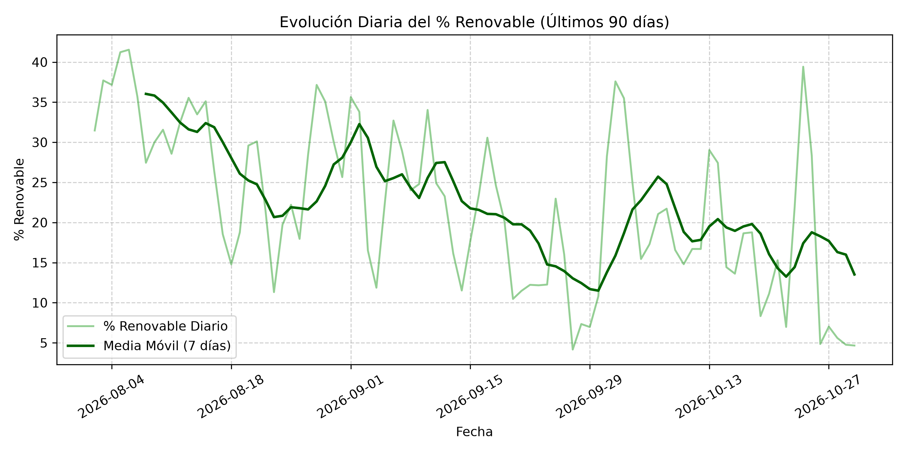
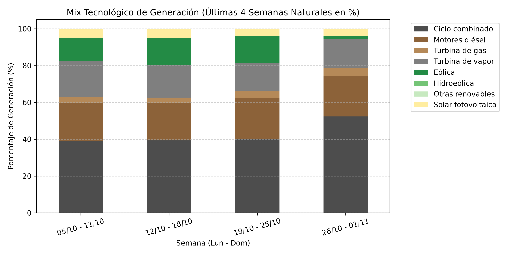
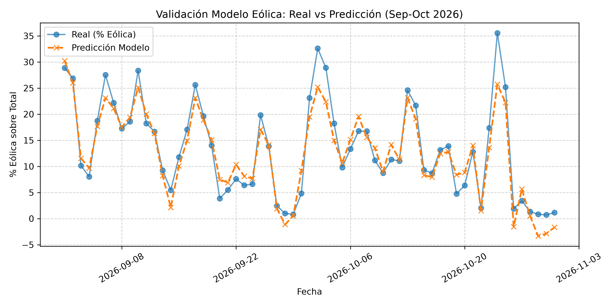

# Análisis y Predicción de Generación Eléctrica en Canarias

## El Problema
El sistema eléctrico de Canarias es un sistema aislado con alta dependencia de combustibles fósiles (ciclo combinado, motores diésel, turbinas de gas/vapor). La penetración de renovables en 2026 tuvo una **media de 2026 (1 de enero – 3 de noviembre) del 21,82 %**, con un mínimo diario del **4,16 %** y un máximo del **41,59 %**. Comprender los factores que impulsan la generación renovable y poder predecirla es clave para la planificación, operación y transición energética de las islas.

## Fuentes de Datos
| Fuente | Descripción | Enlace |
|--------|-------------|--------|
| **REE REData (API pública)** | Estructura de generación del sistema eléctrico de Canarias (identificador 8742), datos diarios por tecnología desde 2026-01-01 | https://apidatos.ree.es/es/datos/generacion/estructura-generacion |
| **Open-Meteo (API gratuita, sin clave)** | Datos meteorológicos históricos y de previsión: viento medio a 10 m, racha máxima, radiación solar. 4 puntos estratégicos con alta concentración de parques eólicos/fotovoltaicos: Arinaga (Gran Canaria), Granadilla (Tenerife), Fuerteventura centro, Lanzarote centro | https://open-meteo.com/ |

## Hallazgo Principal
El viento explica el **85 % de la variación del % renovable total (r = 0,92)**; con el % eólico, **r = 0,94**; la eólica representa el **73 % de la generación renovable**. La generación eólica está fuertemente acoplada al recurso eólico local.

## Modelo Predictivo
Regresión lineal múltiple (4 features: viento medio en Arinaga, Granadilla, Fuerteventura, Lanzarote) entrenada con datos de **enero–agosto 2026** (243 días) y validada en **septiembre–octubre 2026** (61 días):

| Métrica | Valor |
|---------|-------|
| **R² (validación)** | **0.90** |
| **MAE (validación)** | **2,19 p.p.** |
| **Mejora vs. persistencia** | **66 % menos error** (persistencia MAE = 6,33 p.p.) |

El modelo supera claramente a la predicción ingenua (persistencia: "mañana = hoy").

## Gráficas Incluidas
- `graficas/evolucion_renovable_90d.png` — Evolución diaria del % renovable (últimos 90 días) con media móvil 7 días.
  
- `graficas/mix_tecnologia_4sem.png` — Mix tecnológico por semanas naturales (lunes-domingo), renovables agrupadas arriba.
  
- `graficas/validacion_modelo_eolica.png` — Comparación predicción vs. real en validación (Sep-Oct 2026).
  

## Estructura del Proyecto
```
energia-canarias/
├── data/
│   ├── historico.csv      # Generación diaria por tecnología (REE)
│   ├── meteo.csv          # Viento y radiación diarios 4 puntos (Open-Meteo)
│   └── predicciones.csv   # Predicciones diarias % eólica + real + error
├── src/
│   ├── resumen_ree.py          # Resumen diario + actualiza historico + meteo
│   ├── analisis_semanal.py     # Análisis semanal + gráficas
│   ├── rellenar_historico.py   # Backfill histórico REE
│   ├── rellenar_meteo.py       # Backfill histórico Open-Meteo
│   ├── modelo_eolica.py        # Entrena y evalúa modelo regresión eólica
│   ├── predecir_eolica_diaria.py # Predicción diaria con forecast viento
│   ├── evaluar_baseline.py     # Comparativa vs. persistencia
│   ├── ree_utils.py            # Utilidades API REE
│   └── meteo_utils.py          # Utilidades API Open-Meteo
├── graficas/                # PNGs generados
├── models/                  # Modelo entrenado (.pkl)
├── app.py                   # Aplicación Streamlit
├── requirements.txt
└── README.md
```

## Cómo Ejecutar

1. **Instalar dependencias**:
   ```bash
   pip install -r requirements.txt
   ```

2. **Generar datos históricos** (una vez):
   ```bash
   python src/rellenar_historico.py
   python src/rellenar_meteo.py
   python src/modelo_eolica.py
   ```

3. **Predicción diaria** (automatizada por cron a las 08:15):
   ```bash
   python src/predecir_eolica_diaria.py
   ```

4. **Análisis semanal** (automatizado por cron los lunes a las 08:30):
   ```bash
   python src/analisis_semanal.py
   ```

5. **Dashboard interactivo (Streamlit)**:
   ```bash
   streamlit run app.py
   ```

## Automatización
El sistema se ejecuta de forma autónoma mediante un **agente Hermes** con zona horaria **Atlantic/Canary**:
- **Actualización diaria de datos** (08:00): consulta REE, guarda en `data/historico.csv`, descarga meteorología en `data/meteo.csv`.
- **Predicción diaria** (08:15): usa forecast de viento (Open-Meteo, 4 puntos) + modelo lineal → `data/predicciones.csv`.
- **Análisis semanal** (lunes 08:30): % renovable medio, día más/menos renovable, mix 4 semanas, gráficas → `graficas/`.

## Resultados Clave
- Dataset histórico limpio: **307 días** (2026-01-01 a 2026-11-03), sin ceros, huecos ni duplicados.
- % renovable 2026: media **21,82 %**, mín **4,16 %**, máx **41,59 %**.
- Modelo eólico robusto: **R² = 0.90**, **MAE = 2,19 p.p.**, mejora **66 %** vs. persistencia.
- Dashboard Streamlit con visualizaciones interactivas.